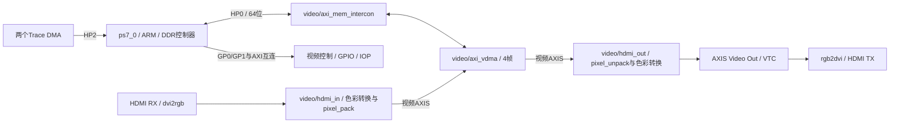

# PYNQ-Z2 官方 Base Overlay 结构分析

审查对象为 Xilinx/PYNQ 固定版本的 **Pynq-Z2** 工程。本文架构已由 Tcl、Python 驱动、XDC 和原理图交叉检查。v2.2.1 的 BD 在2017.4主机重建并验证；板上现成 v3.0.1 Base 的 GPIO、HDMI 和输出帧缓存已验证，原始环境记录已归档。用户同意以现有2017.4优先开发A0，再评估v2.2.1 Base与当前3.0.1驱动适配；较新版本源码未在主机重建。全文“保留/删除”指拟议派生设计，当前官方快照未修改。

## 1. 来源与结构核验

|Tag|Commit|Vivado|源码解析 IP 数|本机状态|
|---|---|---|---:|---|
|v2.2.1|`3d2641653c6d1a5ea55c4c41e15f9dd9a2e32ab3`|2017.4|159|HLS 原始导出失败，经工作副本元数据修正后，官方 BD 创建/验证通过|
|v3.0.1|`93ddd21ab623883590a8c8b07f0b157b2855da4b`|2022.1|187|源码静态审查；现成Base板端GPIO/HDMI/帧缓存已验证；未在主机重建|
|v3.1.2|`3c77124d86bab65ac7bb6beb0aa66e13c83508f2`|2024.1|187|静态审查|

每个 IP 的名称、VLNV/版本、接口、时钟网络、资源状态和处置理由在 [逐 IP 清单](base_ip_inventory.md)；精确参数和地址段在 [base_inventory.json](../results/audit/base_inventory.json)。2017.4的IP Status报告确认159个项目IP；[展开后的实际IP清单](../results/audit/official_v2.2.1/ip_inventory.tsv)还包含互连内部自动生成的coupler/xbar。校验时只将已知AXI Interconnect内部实例归回源码容器，再核对全部159个源码实例。IP数不是LUT、FF或BRAM占用。

## 2. 硬件通路

DDR 控制器在 Zynq PS 中，PYNQ-Z2 的 DDR 接到专用 Bank 502。Base 没有需要重写的 PL DDR 控制器或 MIG。PS 启动、DDR 初始化、SD、Ethernet、USB 和 UART 均复用板卡 preset、匹配 PYNQ 镜像及 Linux 驱动。

三个被审查版本的核心视频路径均为：

- HDMI 输入：`dvi2rgb` → 通道重排 → `v_vid_in_axi4s` → AXIS 寄存器级 → `color_convert` → `pixel_pack` → VDMA S2MM。
- HDMI 输出：VDMA MM2S → `pixel_unpack` → `color_convert` → AXIS 寄存器级 → `v_axi4s_vid_out` → 通道重排 → `rgb2dvi`。
- HDMI 输出时序由 `vtc_out` 生成，时钟由 `axi_dynclk` 生成，TMDS 序列化复用 Digilent `rgb2dvi`。

`pixel_pack/unpack` 是字节/像素打包转换，不是医学图像分析。官方 OpenCV filter/face-detection Notebook 中的 `cv2` 运算在 ARM 上运行，不能作为已有 PL 医学加速器。

## 3. 主要 IP 复用决策

资源栏只有本次得到的局部 HLS 估计带数字；其余未完成完整综合。版本差异必须随实际镜像一起选择。

|实例 / IP|来源和版本|接口及工作时钟|资源成本|拟议处置 / 原因|
|---|---|---|---|---|
|`ps7_0` / processing_system7|AMD/Xilinx 5.5|DDR/FIXED_IO，M_AXI_GP0/1，S_AXI_HP0/2，FCLK|硬 PS + PL 接口成本待综合|保留板级 preset；算法复用空出的 HP2，不重写底层驱动|
|根 AXI 互连 / `video/axi_interconnect_0`|AXI Interconnect 2.1|控制 AXI；视频内部 100/142 MHz|待综合|保留，删支路后按实际从设备数缩减；保留现有时钟适配|
|`video/axi_mem_intercon`|AXI Interconnect 2.1|2 个 SI / 1 个 MI，142 MHz，通向 HP0|待综合|首版保留双通道原设计|
|`video/axi_vdma`|AXI VDMA 6.3|AXI-Lite 100 MHz；DDR/AXIS 142 MHz；MM2S/S2MM|待综合；含行缓冲|保留官方帧缓存及驱动，不开发自制 VDMA|
|`video/hdmi_out/pixel_unpack`|PYNQ HLS 1.0|32 位内存流→24 位视频流；流 142 MHz / 控制 100 MHz|v2.2.1 HLS：874 LUT / 394 FF / 0 DSP / 0 BRAM18|保留像素打包，保持驱动识别名称|
|输入 `pixel_pack`|PYNQ HLS 1.0|24→32 位；流 142 MHz / 控制 100 MHz|HLS：1771 LUT / 1068 FF / 0 DSP / 0 BRAM18|首版保留，后续无 HDMI 输入时可删除|
|输入/输出 `color_convert`|PYNQ HLS 1.0|24 位 AXIS + AXI-Lite；142/100 MHz|每个 HLS 估计：1489 LUT / 1153 FF / 6 DSP / 0 BRAM18|首版保留；输出用配置矩阵，不重写 RGB 通路|
|AXIS 寄存器级|AXIS Register Slice 1.1|视频 AXIS，142 MHz|待综合|保留握手和时序隔离|
|`frontend/axi_dynclk`|Digilent 1.0|AXI-Lite/参考 100 MHz，像素及 5×时钟输出|待综合；MMCM 等硬资源|保留官方驱动及内部时钟约束|
|`frontend/rgb2dvi_0`|Digilent 1.2|24 位并行视频→TMDS；像素/5×像素时钟|待综合；串行器/差分输出资源|保留，不自主实现 TMDS|
|`v_axi4s_vid_out_0`|AMD/Xilinx 4.0|视频 AXIS 142 MHz→像素域；异步 FIFO|待综合|保留官方跨时钟与视频时序同步|
|`vtc_out`|v2.2.1 为 6.1；3.x 为 6.2|控制 100 MHz，视频像素域|待综合|保留官方模式设置；算法 512×512 不直接当作 HDMI 时序|
|`color_swap_0`|旧 VLNV `xilinx:user:color_swap:1.0`；新 `xilinx.com:user:color_swap:1.1`|RGB 并行通道重排|待综合|保留所属版本，不跨版本拷贝假定兼容|
|HDMI HPD GPIO|AXI GPIO 2.0|控制 100 MHz、板级 HPD 引脚|待综合|首版保持参考，但 TX GPIO方向与下载图纸存在疑点，见管脚文档；不自行驱动高电平|
|`dvi2rgb_0`|Digilent 1.7|TMDS RX→并行视频；恢复像素时钟 / 200 MHz延迟参考|待综合|首版保留作官方 Demo 基线；后期仅文件输入时评估删除|
|`v_vid_in_axi4s_0` / `vtc_in`|旧 4.0/6.1，新 5.0/6.2|RX 像素域→142 MHz视频流|待综合|与 RX、EDID/DDC/HPD、相关复位成组评估|
|`btns_gpio/switches_gpio/leds_gpio/rgbleds_gpio`|AXI GPIO 2.0|AXI-Lite 100 MHz，PL 管脚|待综合|保留交互；普通用户 LED 实际使用 AXI GPIO|
|`proc_sys_reset` / 中断控制与拼接|Reset 5.0 / AXI INTC 4.1 / concat 2.1|各自同步时钟域、IRQ_F2P|待综合|保留必要部分，删分支后重做复位/中断连接验证|
|4 个 `iop_*` + BRAM/外设/MDM|MicroBlaze 10.0 等，具体见逐 IP 清单|主要 100 MHz，LMB/AXI/外设 IO|待综合；明确占用 BRAM、LUT/FF|无 PMOD/Arduino/RPi 应用，原 Base 通过后整组删除|
|`trace_analyzer_pi/pmodb`|AXI DMA 7.1，FIFO 1.1，HLS Trace 1.4|100 MHz，S2MM→HP2；MM2S 关闭|待综合；HLS32：1286 LUT/617 FF；64：1350 LUT/849 FF|删除，释放 HP2 与 Trace 相关资源；不是双向医学 DMA 模板|
|`audio_codec_ctrl_0` 与音频时钟/I2C连接|PYNQ音频 IP 1.0 等|AXI-Lite / 音频10 MHz|待综合|不用音频，成组删除；同时去掉 Python `audio.configure()`|
|现代 `address_remap_0` / AXI protocol converter|PYNQ/AMD；见 3.x 清单|主要 IOP 存储访问路径|待综合|只在选择相应3.x版本后按连接归属分析；删 IOP 后评估，不能无依据移植到旧设计|

上述 HLS 数字来自本次 **csynth 估计**，不是布局布线结果。`color_convert` 目标 7 ns，估计 6.38 ns，带 0.88 ns uncertainty 的有效预算仅 6.125 ns，日志仍有时序警告；不可据 6.38<7 就写“时序完全满足”。所有算法资源和完整 B 工程资源还未测量。

## 4. 时钟、复位与 DDR

|时钟域|官方配置 / 用途|派生原则|
|---|---|---|
|PS 输入|50 MHz，原理图 OSC3→PS_CLK E7|不改板级振荡器初始化|
|FCLK0|100 MHz；AXI-Lite、GPIO、主要 IOP、HDMI动态时钟参考|新增算法/DMA先用100 MHz；保持控制域|
|FCLK1|142 MHz；视频内存 AXI、pack/unpack/color、VDMA流|首版 B 原样保留|
|FCLK2|200 MHz；HDMI RX延迟参考|保留RX时保留；去RX后评估释放|
|FCLK3|100 MHz；Trace流、Trace DMA|删除Trace后评估；新增算法不依赖Trace复位|
|TX 像素/串行|`axi_dynclk`；720p60常用74.25 / 371.25 MHz|使用官方 VideoMode 及动态时钟驱动|
|RX 像素|`dvi2rgb` 恢复，取决于输入模式|不得当作无视频信号时也存在的系统时钟|
|外部 PL CLK125|H16 来自 Ethernet PHY；PHY复位时可能无输出|算法优先用PS FCLK，不依赖它|

视频 AXI-Lite 和流时钟不同，通过现有互连及 IP 多时钟接口衔接。新增通路如存在不同域，使用标准 Clock Converter/FIFO，不能把两个时钟域的 TVALID/TREADY 直接连起来。

`video/proc_sys_reset_pixelclk` 的同步时钟和锁定输入来自 HDMI RX，服务接收侧。去掉 RX 时必须同步删除或重新设计接收复位相关分支；不能留下由不存在 PixelClk 驱动的 reset。TX `rgb2dvi/aRst_n` 关联 `axi_dynclk/LOCKED_O`，输出跨时钟由官方视频 IP 处理，不能借用 RX reset 随意替换。

PS HP0 和 HP2 在官方 preset 中均为 **64 位**；VDMA 的 MM2S memory/stream 明确设为 **32 位**，宽度由互连适配。不要因 VDMA 是32位而把 PS HP 接口宽度改错。S2MM 未显式设置的参数以对应版本 IP 默认值和生成 BD/HWH 为准，不补造“32位”参数。

|参考版本|VDMA可见DDR地址窗口|
|---|---|
|v2.2.1|`0x00000000 .. 0x1FFFFFFF`（512 MiB窗口）|
|v3.0.1 / v3.1.2|`0x10000000 .. 0x1FFFFFFF`（256 MiB窗口）|

较新版本窗口变化会影响 CMA/帧分配验证。必须检查实际分配缓冲的物理地址和整个 `[address,address+nbytes)` 都落在选定 HP 地址段内；不要直接扩大窗口来掩盖镜像不匹配。

## 5. 驱动、名称及控制地址

旧版本视频驱动为 `pynq/lib/video.py`；3.x 拆为 `pynq/lib/video/{hierarchies,dvi,dma,pipeline,...}.py` 并调用 `_video` 本地库。**不能只复制较新 Python 文件到旧系统。**

3.x `VideoOut.checkhierarchy` 要求 `pixel_unpack`、`color_convert`、`frontend`；`frontend` 依赖 `vtc_out` 和 `axi_dynclk`。外层 `VideoWrapper` 自动绑定要求 VideoIn、VideoOut 和 AxiVDMA 同时存在，再把 VDMA 交给输出子管线。v2.2.1 的 HDMI 外层也检查输入与输出完整结构。去掉 RX/S2MM 后，现成外层可能不能绑定，需要一个小型、版本专用的 `RetinaOverlay`/Hierarchy wrapper 显式连接保留的 VideoOut 与 AxiVDMA；下层视频驱动照常复用。

原 `BaseOverlay.__init__` 会访问所有 IOP、Trace、音频和共享 IO GPIO。硬件删掉这些模块后不能继续原样实例化该类。推荐继承 `Overlay`，仅初始化保留 GPIO、视频和新 DMA/算法 IP。这属于控制包装适配，不是重写 PYNQ 底层。

以下为各被审查版本相同的**官方源码参考地址**，范围均为 `0x10000`；实际部署从配套 HWH/旧版元数据读取，不在应用中盲目写死。

|IP/控制块|参考基址|
|---|---|
|VDMA|`0x43000000`|
|TX 动态时钟 / TX VTC / RX VTC|`0x43C10000` / `0x43C20000` / `0x43C30000`|
|RX pixel_pack / RX color_convert|`0x43C40000` / `0x43C50000`|
|TX color_convert / TX pixel_unpack|`0x43C60000` / `0x43C70000`|
|switches / buttons|`0x41200000` / `0x41210000`|
|RX HPD / TX HPD GPIO|`0x41220000` / `0x41230000`|
|RGB LED / LED|`0x41240000` / `0x41250000`|
|系统 AXI INTC|`0x41800000`|
|音频（拟删除）|`0x43C00000`|

## 6. 像素格式与算法接口

官方显示默认 24 bpp 的 `PIXEL_BGR`，32 bpp 默认 `PIXEL_RGBA`，也有 8位灰度模式。内存字节组织、色彩矩阵和 TMDS RGB 通道次序由官方 pack/unpack/color_swap 配合处理，应使用明确的 `VideoMode(...,24)` 和 `PIXEL_BGR` 后用红绿蓝测试图验证。

RetinaFPGA 输入 `[B,G,R,FOV]`、输出 `[G,enhanced,mask,response]` 各占32位，是医学算法数据记录，**不能作为 RGBA 直接送给 HDMI**。PS 根据输出构成 BGR 画面（原图、增强图、二值结果和叠加），再提交 VDMA 显示；像素医学计算在 PL。512×512可放进1280×720画布，不重新开发512×512 HDMI时序。

Simple AXI DMA 以帧为一个包，TLAST只在最后一个像素；视频 AXIS 使用 TUSER 标记帧首、TLAST标记每行末。推荐独立 DMA 分析通路和官方 VDMA 显示通路，通过 DDR 交换图像。未来如直接接视频流，必须验证协议桥，不直接把帧包算法接到行包 VDMA。

## 7. 阶段结论

当前选择“官方 Base 派生 + 独立算法 DMA + 官方 VDMA/HDMI 显示”。首个整合版本保留 RX，优先删除音频、4个 IOP、Trace 和相关扩展 IO；待运行稳定、资源报告证明有必要后再精简 RX。A 工程先验证 DMA/算法，B 工程同时包含算法和 HDMI，一次加载一个完整 bitstream。

本次只完成参考 BD 验证，未发布派生 Overlay，也未宣称官方 HDMI 或医学算法在板上通过。详细实施顺序见 [推荐架构](vivado_architecture.md)，实测入口见 [Demo验证计划](demo_validation_plan.md)。
