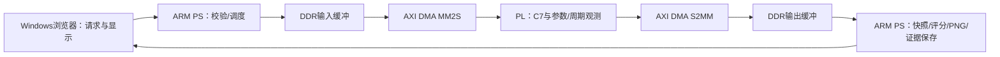

# C7眼底血管检测系统：交付技术报告（重启与视频待补）

版本日期：2026-10-16。交付基线为已核验C7，新增亮区/细血管优化按用户要求暂缓。W4与W5a/W5b的指定范围已独立核验；本轮七次软件演示也已核验；用户确认没有执行重启或录像，正常重启演示及视频待补，不能写为项目全部验收。

## 系统与职责

系统采用PYNQ-Z2（XC7Z020）、SD上的PYNQ 3.0.1/Linux/Python 3.10、以太网及Windows浏览器。Jupyter管理入口9090，实验服务8090；不需要HDMI。C7在PL中计算36项局部特征和8棵深度6整数树的分数，推荐阈值112。人工标注仅用于离线拟合、真实输出评分，不参与运行时推理。

Windows CPU负责网页解码与绘制，ARM负责输入处理、DMA调度、输出解包和评分等；血管检测核心在PL执行。不是整套系统完全不使用CPU。输入输出以uint32打包，256或512正方形帧，512每方向1,048,576字节；最终模式包含原FOV约束。尺寸转换、填边、绿色通道、分数与字节定义沿用冻结模型与协议，不在展示端补线、删点或错误回退。

硬件复用已验证PS/DDR/DMA/时钟/复位基础通路。DMA控制地址0x40400000，配置GPIO0x41200000，观测GPIO0x41210000；以配对HWH和运行时校验为准。每次真实任务保留输入输出、SHA、配置锁存、帧序号、周期、DMA状态和CPU单调时钟。浏览器观察关联同一任务，不将旧图刷新算作新帧。

## Vivado的实际作用

Vivado HLS 2017.4生成算法RTL；Vivado 2017.4进行系统集成、RTL仿真、综合、布局布线、时序与资源检查，并生成板卡实际加载的bitstream。Jupyter加载现成bitstream，故每轮网页实验不重新启动Vivado。

可信实现是原工程build/q4d_detector_full_02，不是时序失败的full_01。目标100MHz，WNS +0.107ns，WHS +0.026ns；38,373 LUT、24,833 FF、97.5 BRAM Tile、30 DSP。配对bit SHA256为`5e2db8efe220d24620c30e22bc3bfac3771330ab54c415cb8326da3ec775c294`，HWH为`2e40e3a8bf176b6cabd4916df97ad00e2a72d3a6fc4fd32c13db14e6d8ed3890`。完整构建路径、复现边界见[c7_vivado_handoff.md](c7_vivado_handoff.md)。

HLS03通过18帧、2,555,904字及9,720特征值对照。实际RTL为8组独立复位的分片测试，17独立完整帧、2,490,368字；含7重复种子共24帧、3,145,728字，不能称一次连续18例。背压、坏TLAST/TKEEP、在途复位等以原仿真证据为准。导出日期溢出、初次delta限制与full_01负时序均保留，不隐藏失败。

## 实测结果与边界

| 项目 | 已核验范围 | 结论与限制 |
|---|---|---|
| C7初始板测 | 194任务/160固定帧，35,127,296字、970PNG | 实际输出与冻结参考一致；非临床验收 |
| W4.1同板CPU/PL | 618 PL＋618 ARM调用，202,506,240字 | 256/512各三轮正式100样本；CPU为NumPy/OpenCV同输出参考，非最优ARM实现 |
| W4b浏览器 | 309任务，81,002,496字、1545PNG | 三轮实际FPS 0.568648 / 0.569180 / 0.575442 |
| W4c纯DMA | 独立回环619事务，101,253,137字 | 不能用C7模式0或DMA减核心替代 |
| W5a长稳 | 1000任务、33.73分钟，183,500,800字、5000PNG | 限速约0.494FPS，不是新的最高FPS；RSS后900帧增长约3.086MiB |
| W5b交互 | 42任务，7,667,712字、198PNG；51检查 | 模式/阈值边界、队列准入、HTTP客户端关闭、页面刷新、无GT、导出通过指定范围 |
| 功耗 | Vivado片上估计2.572W | NOT_MEASURED_NO_INSTRUMENT；不是整板实测 |

512处理性能三轮中位数：PL核心约3.040ms，配置至CPU快照约33.9～34.0ms，包含校验/分配等的完整PL调用约142.5～143.0ms，ARM参考调用约19.1～19.2秒。网页请求至绘制中位数约1.71秒，实际约0.57FPS。不能把3.040ms倒数写成整套实时帧率。DMA和核心重叠，不相加、不相减推导纯搬运；浏览器和板端时钟不跨机相减。PNG编码/写盘是当前较大开销，但本轮未修改处理链。

详细统计见c7_w4_processing_results_2026-10-16.md、c7_w4_browser_results_2026-10-16.md、c7_w4_dma_results_2026-10-16.md、c7_w5a_results_2026-10-16.md、c7_w5b_results_2026-10-16.md。历史报告中的“下一步未做”是当时状态，当前以本表与对应最新核验JSON为准。

质量采用STARE原20图、AH/VK分别评价，两尺寸、训练重代入与复用留出分别报告，见[c7_delivery_quality.md](c7_delivery_quality.md)。不得将单幅AH Dice0.649称全数据准确率，不得将复用留出称新的盲测。亮区残余误检、细血管漏检仍在；用户已接受当前视觉效果并暂缓优化，历史门禁失败保持原结论。

## 安全结束与剩余验收

真实错误或超时停止提交并保存现场，不自动重试、重置、重载FPGA或释放故障在途缓冲。正常关闭仅允许IDLE、无pending/error/retained状态。W5b不是物理拔网线或在途断电恢复；正常关机重启演示也不冒充此类故障测试。

七次软件演示现已真实核验：7任务、1,835,008输出字、31PNG，一次加载并安全关闭。用户明确没有先正常关机断电重启，也没有录像，因此重启验证与视频仍未完成。见c7_demo_results_2026-10-16.md。下一轮在新目录retina_c7_demo_reboot_r2复用原两文件，正常重启后做七次并录像；不用重跑W4/W5。已整理提交入口c7_submission_index.md，视频与重启证据补齐后完成提交核对。
