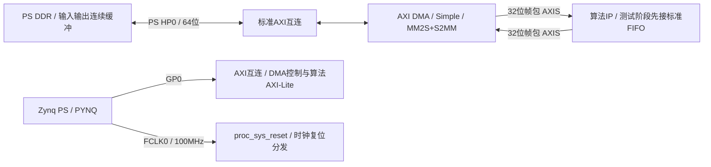
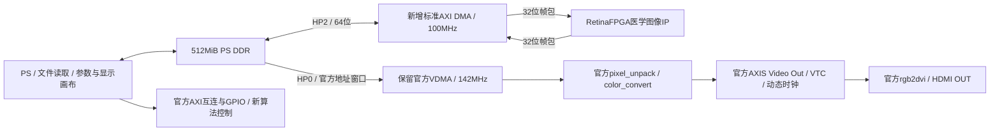

# RetinaFPGA 推荐 Vivado 架构及技术复用方案

状态：2026-10-11 用户同意优先使用现有 Vivado 2017.4，2022.1 安装暂缓。板端保留已验证的 PYNQ 3.0.1 / v3.0.1 官方 Base。A0 采用 TUL Z2 preset + 本机标准 DMA/FIFO；B 候选从匹配2017.4的官方 v2.2.1 Base 派生，与当前 Python 驱动的适配须独立验证，不能仅改工具版本检查。冻结医学算法已完成A4实体板61帧验证，PCB修订仍待核对。B同工程已完整实现，并完成实体板370帧与两种显示画面核验；512带显示完整循环基线1.601FPS，仍待分段性能优化，见[B板测报告](../results/b_integration_2017_4_r2/board_execution_2026-10-12/verification_report.md)。A0 r2的独立DMA回环已板测通过，原始记录已复核归档；构建与板测状态见 [A0 报告](../results/a0_dma_2017_4_r2/build_report.md)，操作见 [验证步骤](a0_dma_validation_steps.md)。

## 1. 最终架构选择

**采用双工程、同一算法 IP：A 最小 DMA 验证 Overlay；B 从匹配版本官方 Pynq-Z2 Base 派生，保留 PS/DDR 和 HDMI/VDMA，同时包含相同的 DMA 算法通路。** 算法结果通过 DDR 交给展示端。B 不通过切换 A/B bitstream 来完成一次处理显示。

选择理由：官方已经提供成熟 HDMI、帧缓存、PS 和 Python 驱动；分析帧包与显示视频流的协议不同，分离通路能减少 BD 改动。最初由 PS 做图像读入、FOV加载、展示画布/文字和参数控制，PL 完成预处理及血管分析，符合医学运算主要在 PL 的目标。

## 2. A：最小验证 Overlay

A 先复用 **PYNQ-Z2 的 PS preset** 创建小型工程，不从别的板卡复制 PS 配置。测试阶段把 DMA 接到成熟 AXIS Data FIFO/寄存器级完成双向 loopback，确认存储与缓存维护；通过后替换为算法 IP。标准 DMA、互连和 AXI-Lite 接口优先用 Vivado IP 模板/成熟实现。

|模块|配置原则|
|---|---|
|PS|Z2官方DDR/MIO/preset；GP0控制，HP0内存；100MHz FCLK0|
|AXI DMA|对应工具版本 `axi_dma:7.1`；MM2S+S2MM；Simple；SG=0、Micro DMA关闭|
|长度寄存器|建议23位。512×512×4=1,048,576字节，20位最大值只有1,048,575，至少21位|
|DMA内存AXI|A0实配MM2S64位、S2MM32位（2017.4按输入流自动推导）；标准互连转换至HP0的64位。AXIS32位；DRE关闭，统一8字节地址对齐、长度为4字节倍数|
|算法流|一像素一32位beat，TKEEP=0xF；TLAST只在帧末；所有计数在TVALID&&TREADY时更新|
|控制|分辨率、阈值、模式、start/status、帧计数/周期、错误位；具体寄存器表在算法规格阶段冻结|
|复位|使用proc_sys_reset同步到100MHz；复位后不保留上一帧窗口/计数状态|
|中断|DMA和算法按需求接成熟PS中断路径；首版也可带超时轮询，不能无限wait掩盖TLAST错误|

## 3. B：最终整合 Overlay

派生步骤：固定 Commit 的官方 Base 工作副本 → 原 Base Demo 基线 → 删除不用的音频/IOP/Trace → 重新验证视频/GPIO → 将 A 已通过的算法 DMA 支路接到释放的 HP2 → 重新验证 DDR 并发、显示和交互。首版保留 HDMI RX 和双向 VDMA，使原外层视频驱动保持完整；RX占用过高时再成组删除，并实现小型驱动绑定适配。

HP0 保持官方142MHz视频路径；算法 DMA 使用100MHz FCLK0并接HP2，保证对应S_AXI_HP2_ACLK和reset同步。保留PS64位HP参数，不把PHY输出125MHz作为算法时钟。AXI控制仍接GP0或可用控制互连，实际端口数和地址以Tcl生成结果为准。

B实际地址已由生成BD/HWH检查：算法DMA `0x40400000`，配置GPIO `0x43C80000`，各64KiB；原开关GPIO `0x41200000`和视频VDMA `0x43000000`不变。配置/DMA分别使用原GP0的M03/M06，算法DDR接HP2/FCLK0。应用严格匹配配对HWH；不以改版本检查代替驱动绑定和显示实测。

## 4. 缓冲与显示

|项目|确定的接口/理论存储需求|实现约束|
|---|---|---|
|512×512 输入/输出|各1MiB；算法往返至少2MiB/帧|输入`uint32`按低字节B,G,R,FOV；输出低字节G,增强,mask,response|
|256×256 输入/输出|各256KiB|可选调试模式；独立图像规范|
|算法 ping-pong|两组输入+输出共4MiB（尚未实现）|缓冲生命周期和send/recv/display所有权明确|
|1280×720 BGR24 显示帧|2,764,800字节；4帧11,059,200字节|使用官方newframe/writeframe和实际stride|
|720p60扫描读带宽|仅有效像素约165.888MB/s|再加算法DMA、PS画布写入及AXI突发开销；不等于已测DDR带宽|

首版优先720p显示，两幅512×512图并排加状态文字；更多面板/缩放由展示端布局实现。显示60Hz与医学算法FPS分开记录，不能用显示刷新率冒充推理/分割帧率。100MHz、II=1的512×512纯像素理想下限为2.62144ms；尚不包含窗口填充/排空、DMA和CPU展示成本，不作为性能承诺。

PYNQ较新镜像用`allocate`；v2.2.1原例使用`Xlnk`，具体分配、flush/invalidate和释放跟实际驱动版本走。使用PS HP非一致性路径时保证输入对PL可见、输出对CPU可见。显示帧提交后按官方驱动管理释放和复用，不覆盖正在扫描的缓冲。要验证所有物理缓冲落在对应版本的DDR可访问窗口内。

## 5. 医学模块复用边界

本次已找到和保存 Vivado HLS 2017.4 自带视频库及固定Tag的 xfOpenCV候选信息。通用Gaussian、box、LUT、threshold、erosion、dilation已有厂商实现，下一阶段先比较定点、边界、握手和资源。优先复用兼容实现/生成RTL，或为精确接口和数值规格作必要改造。任务书要求Verilog/SystemVerilog核心，因此采用生成RTL或自行实现缺失医疗逻辑的理由必须记入后续模块审查。

需要项目专门实现或集成的部分：FOV通道与窗口对齐、固定点血管响应、可配置阈值/模式、稀疏方向核（若M0质量评估选择）、多阶段旁路/结果打包、帧级控制和性能计数，以及独立Python bit-accurate参考。GT只用于离线评价，不能进入待分析图像通路。通用行缓存可优先采用厂商linebuffer/BRAM与成熟FIFO；不要提前把所有通用滤波归为“必须从零开发”。

当前旧xfOpenCV高斯按sigma生成量化系数，box参考仅支持constant border；任务书固定核/replicate border等要求不能假定直接相同。必须逐像素验证后决定是否复用、改造或者记录理由采用定点专用RTL。新版Vitis Vision候选需2022.x/2024.x匹配环境，不能直接在2017.4导入。

## 6. 验证与回退顺序

1. 本阶段：官方来源、版本、原理图/XDC、驱动绑定及主机工具审查；已完成可执行的主机检查。
2. 板卡到手：确认PCB和镜像，运行原始Base LED/HDMI/帧缓存，保留原Notebook、环境和实测记录。
3. A0：标准DMA loopback，递增/随机图案、256/512帧、至少连续多帧，检测超时/状态/字节数。
4. 算法规格：STARE公开数据与CPU基线、定点逐像素参考、模块复用记录；再开发PL医学模块。
5. A1：模块/全帧仿真（边界、背压、复位、多帧、TLAST），板端DMA输出与参考比对。
6. B0：官方Base精简，每次只删除一个功能组；验证BD/地址/时钟/XDC和LED/HDMI回归。
7. B1：接入已通过的A算法支路，实测结果一致性、端到端延迟、算法FPS、显示连续性、资源/时序和功耗可测项。

每一步建立Git提交和可追溯源Tag；bit/HWH/报告/源码Commit形成配套清单。错误先对比前后BD、时钟、地址和XDC，回退到上一通过版本定位。原始资源快照和工作工程分开，不能覆盖“通过”的结果日志来伪造连续成功。

最小工程已有入口 `vivado/scripts/build_minimal_dma.tcl`（标准 FIFO loopback，尚无算法），完整 B 的 `build_retina_overlay.tcl` 待 A0 板测及旧版 HDMI 适配完成后实现。不能把 A0 标作完整医学工程。
